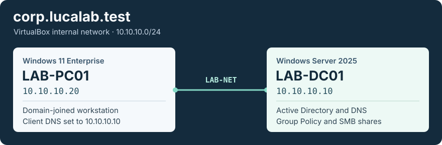

# Windows Enterprise Helpdesk Lab

I built a two-machine Windows domain in VirtualBox to work through service desk requests. The five tickets below cover sign-in, shared drives, Group Policy and DNS. Each records the symptom, the change and what happened when I tested again on the Windows 11 workstation.

## When the server answers but Group Policy fails

On `LAB-PC01`, a connection to port 445 on the server's IP address succeeded. Looking up the same server by name timed out. That pointed to the workstation's DNS settings. After I restored the domain DNS server and cleared the client cache, the name resolved, both user and computer policy updated, and the workstation's secure-channel check returned `True`.

[Read ticket 005 and the commands](tickets/005-incorrect-dns-breaks-domain-services.md) · [Failure output](screenshots/10-dns-broken-state.svg) · [Recovery output](screenshots/11-dns-restored-state.svg)

## Four more service desk tickets

| What the user or technician saw | What confirmed the fix |
| --- | --- |
| [001 · Finance share returns “Access is denied”](tickets/001-finance-share-access.md) | After group membership was restored and the user signed in again, they opened the share and created a test file. |
| [002 · Windows rejects a standard user's sign-in](tickets/002-workstation-inherited-domain-controller-policy.md) | Event 4625 and the effective logon rights exposed an OU placement error. The user signed in after the OU was moved and the workstation restarted. |
| [003 · User policies are linked but missing](tickets/003-user-gpo-not-applying.md) | After enabling the user side of the GPOs, `gpresult` listed them and the screen-saver policy took effect. |
| [004 · The workstation baseline is missing](tickets/004-workstation-gpo-computer-settings-disabled.md) | After enabling the computer side of the GPO, `gpresult /scope computer /r` listed the workstation baseline alongside the default domain policy. |

For the employee's side of a ticket, see [My Finance drive is missing](docs/finance-drive-help.md). It walks through what to try in File Explorer and what to tell the service desk.

## Account onboarding and offboarding

| Workflow | Checks recorded in the lab |
| --- | --- |
| [Onboard a user](docs/user-onboarding.md) · [PowerShell script](scripts/New-LabUser.ps1) | A new Finance user signed in, received the Finance and Public drives, and created, read and deleted a Finance file. The Sales share correctly denied access. |
| [Offboard a user](docs/user-offboarding.md) · [PowerShell script](scripts/Disable-LabUser.ps1) | The account was disabled, its department membership was removed, and it was moved to the Disabled Users OU. A fresh workstation sign-in was rejected. |

I also tested both scripts with a delegated helpdesk account. The run notes show the `-WhatIf` preview, the domain controller used and the resulting account and group memberships. [Delegated administration](docs/delegated-helpdesk-administration.md) · [PowerShell preview and verification](docs/powershell-automation-safety.md)

## Lab environment

The lab domain is `corp.lucalab.test`. Finance access follows a group chain from the user's account to `GG-Finance`, then to `DL-Finance-RW`, which holds the share and NTFS permissions.

| Build notes | Documentation |
| --- | --- |
| Domain and workstation | [Architecture](docs/architecture.md) · [Active Directory](docs/active-directory.md) · [OU layout](docs/directory-structure.md) · [Domain join](docs/workstation-domain-join.md) |
| Drives, policy and networking | [SMB and NTFS permissions](docs/file-sharing-and-permissions.md) · [Drive mappings and Group Policy](docs/group-policy.md) · [DNS checks](docs/dns-network-troubleshooting.md) |

## Lab evidence

The PNG files are screenshots. The SVG evidence panels reproduce captured settings or command output so the text stays legible when enlarged.

| Evidence | Files |
| --- | --- |
| Windows screenshots | [Domain controller](screenshots/01-domain-controller.png) · [OU tree](screenshots/02-expanded-OU-tree.png) · [Finance group](screenshots/03-security-group-members.png) · [Drive mappings](screenshots/05-gpo-drive-mapping.png) · [Helpdesk group](screenshots/06-delegated-helpdesk.png) · [Onboarding preview](screenshots/07-powershell-onboarding-whatif.png) |
| Rendered settings and output | [Finance NTFS permissions](screenshots/04-finance-ntfs-permissions.svg) · [Onboarding result](screenshots/08-powershell-onboarding-success.svg) · [Offboarding result](screenshots/09-powershell-offboarding-success.svg) · [DNS failure](screenshots/10-dns-broken-state.svg) · [DNS recovery](screenshots/11-dns-restored-state.svg) |
